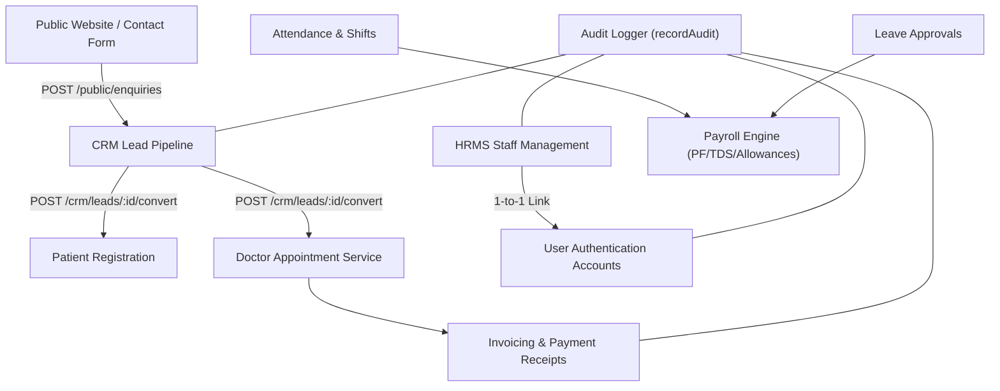

# TriGyna Health & Wellness — Complete Admin Dashboard + CRM + HRMS System Design Spec

**Date:** 2026-10-24  
**Author:** Antigravity Architect  
**Status:** Approved for Implementation (Approach A: In-Place Extension of Existing Stack)

---

## 1. System Context & Architecture Overview

TriGyna Healthcare Management System integrates public patient-facing web workflows with a comprehensive internal management portal.

### 1.1 Technology Stack (Active & Preserved)
- **Frontend:** Next.js 16.4 (App Router) + React 19 + Tailwind CSS v4 in `src/`.
- **Backend:** Node.js + Express.js modular REST API in `apps/api/src/` on port 5000.
- **Database:** MongoDB (Mongoose) at `mongodb://127.0.0.1:27017/trigyna`.
- **Authentication & RBAC:** JWT bearer tokens + session cookies, role verification middleware (`requireAuth`, `requireRole`) supporting roles: `owner` (Super Admin), `admin`, `doctor`, `reception`, `crm`, `hrms`, `finance`, `patient`.
- **Financial Minor Units:** All monetary amounts are handled and stored as rounded currency values (INR) with server-side validation against client manipulation.

### 1.2 Module Topology & Shared Entities

---

## 2. CRM Module Specification

### 2.1 The Canonical 5-Status Pipeline
As strictly required, the CRM pipeline enforces exactly five stages:
1. **`new` (New):** Ingested from public website form (`POST /public/enquiries`), WhatsApp webhook, phone call, or staff manual entry.
2. **`contacted` (Contacted):** Initial outreach logged via phone call or WhatsApp; includes next follow-up schedule and notes.
3. **`qualified` (Qualified):** Lead verified for clinical care program interest, budget, and consultation preference.
4. **`converted` (Converted):** Transactional conversion resulting in linked `Patient` record, `Appointment` booking, and `Invoice`. Idempotent.
5. **`lost` (Lost):** Lead not proceeding. Requires mandatory `lostReason` and notes.

*Legacy status migration:* Existing records stored with legacy statuses (`interested`, `consultation_booked`, `nurture`) will be mapped seamlessly on read and migration (`interested` -> `qualified`, `consultation_booked` -> `converted`, `nurture` -> `contacted`) ensuring backward compatibility.

### 2.2 CRM API Contract (`/api/v1`)
| Method | Endpoint | Authorization | Description |
|---|---|---|---|
| POST | `/public/enquiries` | Public (Rate Limited) | Ingests website enquiries into CRM as `status: 'new'`. |
| GET | `/crm/dashboard` | `owner`, `admin`, `crm`, `reception` | Alias to `/crm/overview`: aggregated counts, funnel, conversion rate. |
| GET | `/crm/overview` | `owner`, `admin`, `crm`, `reception` | Primary overview metrics and lead distribution. |
| GET | `/crm/stages` | `owner`, `admin`, `crm`, `reception` | Returns the canonical 5 pipeline stages and metadata. |
| GET | `/crm/leads` | `owner`, `admin`, `crm`, `reception` | Filtered, searchable, paginated list of leads. |
| POST | `/crm/leads` | `owner`, `admin`, `crm` | Create a new lead manually. |
| GET | `/crm/leads/:id` | `owner`, `admin`, `crm`, `reception` | Retrieve full lead details, activities, tasks, notes. |
| PATCH | `/crm/leads/:id` | `owner`, `admin`, `crm` | Update lead properties. |
| PATCH | `/crm/leads/:id/status` | `owner`, `admin`, `crm` | Validated status transition (requires `lostReason` if moving to `lost`). |
| POST | `/crm/leads/:id/mark-lost` | `owner`, `admin`, `crm` | Sets status to `lost` with captured reason. |
| POST | `/crm/leads/:id/assign` | `owner`, `admin`, `crm` | Assign or reassign lead owner. |
| PATCH | `/crm/leads/:id/assign` | `owner`, `admin`, `crm` | PATCH alias for assignment. |
| GET | `/crm/leads/:id/activities` | `owner`, `admin`, `crm`, `reception` | Retrieve timeline of notes, calls, task events. |
| POST | `/crm/leads/:id/activities` | `owner`, `admin`, `crm` | Record a call, WhatsApp, or meeting activity. |
| GET | `/crm/follow-ups` | `owner`, `admin`, `crm`, `reception` | List due, overdue, and upcoming follow-ups. |
| POST | `/crm/leads/:id/follow-ups` | `owner`, `admin`, `crm` | Schedule a follow-up task on a lead. |
| PATCH | `/crm/follow-ups/:id` | `owner`, `admin`, `crm` | Update or complete a follow-up task. |
| POST | `/crm/leads/:id/convert` | `owner`, `admin`, `crm` | Transactional conversion to patient, appointment, and invoice. |
| GET | `/crm/reports/conversions` | `owner`, `admin`, `crm` | Detailed conversion statistics by staff and acquisition source. |

---

## 3. HRMS Module Specification

### 3.1 Sub-systems & Business Logic
1. **Staff Directory (`Employee`):**
   - Stores employee code (`TG-EMP-XXXX`), designation, department, shift, salary, emergency contacts, and active employment status.
   - Tied 1-to-1 to `User` login credentials.
   - Offboarding marks employee as `offboarded` and suspends `User` account while retaining all attendance and payroll records for audit.
2. **Attendance & Shifts (`AttendanceRecord` & `AttendanceCorrection`):**
   - Biometric or portal punch timestamps (`check-in`, `check-out`).
   - Calculation of hours worked and late flags based on assigned shift.
   - Correction requests submitted by employees and approved by HR/Admin.
3. **Leave Management (`LeaveRequest`):**
   - Configurable balance tracking (Casual, Sick, Earned, Unpaid).
   - Validation against overlapping dates and available balance.
   - Dedicated approval (`POST /hrms/leaves/:id/approve`) and rejection (`POST /hrms/leaves/:id/reject`) endpoints.
4. **Payroll & Payslips (`PayrollRecord`):**
   - Computes base salary, allowances, statutory deductions (PF, Professional Tax, TDS) taking into account unpaid leave days and finalized attendance.
   - Draft generation -> Approval -> Finalization & locking.
   - Digital payslip rendering (`GET /hrms/payslips/:id`).

### 3.2 HRMS API Contract (`/api/v1`)
| Method | Endpoint | Authorization | Description |
|---|---|---|---|
| GET | `/hrms/dashboard` | `owner`, `admin`, `hrms`, `hr` | HR KPIs (headcount, present today, on leave, pending requests). |
| GET | `/hrms/employees` | `owner`, `admin`, `hrms`, `hr` | List active & offboarded employees. |
| POST | `/hrms/employees` | `owner`, `admin`, `hrms`, `hr` | Onboard new employee with auto-generated user credentials. |
| GET | `/hrms/employees/:id` | `owner`, `admin`, `hrms`, `hr` | Employee profile details. |
| PATCH | `/hrms/employees/:id` | `owner`, `admin`, `hrms`, `hr` | Update employee information. |
| POST | `/hrms/employees/:id/offboarding` | `owner`, `admin`, `hrms`, `hr` | Terminate access and record exit interview details. |
| GET | `/hrms/departments` | `owner`, `admin`, `hrms`, `hr` | List organization departments. |
| POST | `/hrms/departments` | `owner`, `admin`, `hrms`, `hr` | Add new department. |
| GET | `/hrms/shifts` | `owner`, `admin`, `hrms`, `hr` | List work shifts and timing policies. |
| POST | `/hrms/shifts` | `owner`, `admin`, `hrms`, `hr` | Configure shift roster. |
| POST | `/hrms/attendance/check-in` | Authenticated | Record check-in punch for the logged-in user's employee profile. |
| POST | `/hrms/attendance/check-out` | Authenticated | Record check-out punch and compute working hours. |
| GET | `/hrms/attendance` | `owner`, `admin`, `hrms`, `hr` | Retrieve attendance records across employees. |
| POST | `/hrms/attendance/corrections` | Authenticated | Submit correction request for missing or altered punch. |
| GET | `/hrms/attendance/corrections` | `owner`, `admin`, `hrms`, `hr` | List pending attendance corrections. |
| PATCH | `/hrms/attendance/corrections/:id/review` | `owner`, `admin`, `hrms`, `hr` | Approve or reject attendance correction. |
| GET | `/hrms/leaves` | Authenticated | List leave requests (scoped to self for employees, all for HR). |
| POST | `/hrms/leaves` | Authenticated | Submit leave application. |
| POST | `/hrms/leaves/:id/approve` | `owner`, `admin`, `hrms`, `hr` | Approve leave application and deduct balance. |
| POST | `/hrms/leaves/:id/reject` | `owner`, `admin`, `hrms`, `hr` | Reject leave application with reason. |
| GET | `/hrms/payroll` | `owner`, `admin`, `hrms`, `finance` | List monthly payroll runs. |
| POST | `/hrms/payroll/runs` | `owner`, `admin`, `hrms`, `finance` | Generate monthly payroll draft. |
| POST | `/hrms/payroll/runs/:id/approve` | `owner`, `admin`, `finance` | Approve payroll draft. |
| POST | `/hrms/payroll/runs/:id/finalize` | `owner`, `admin`, `finance` | Finalize and lock payroll against further modification. |
| GET | `/hrms/payslips/:id` | Authenticated | Retrieve structured payslip (restricted to owner employee or HR/Admin). |

---

## 4. Admin Dashboard Workspace Integration

1. **Overview Dashboard Tab (`AdminOverviewExact.tsx`):**
   - Real-time DB KPIs: Patients, Appointments Today, Revenue Collected, Unpaid Dues, CRM Leads Funnel, Staff On-Duty, Pending Leaves.
2. **CRM Tab (`CrmExactTab.tsx`):**
   - 5-Column Kanban Board (`New`, `Contacted`, `Qualified`, `Converted`, `Lost`).
   - Drag-and-drop or status dropdowns triggering `PATCH /crm/leads/:id/status`.
   - Modals for Lead Details, Adding Activities, Scheduling Follow-ups, and Transactional Conversion.
3. **HRMS Tab (`HrmsTab.tsx`):**
   - Sub-tabs: Directory, Attendance, Leaves, Activity, and Payroll.
   - Action buttons for Check-in/Check-out, Leave Approvals, Correction approvals, and Payroll Finalization.
4. **Billing Tab:**
   - Real-time invoices, partial payment recording, and dynamic A4 PDF receipt generation.

---

## 5. Verification & Testing Protocol

The implementation will be verified through:
1. **Automated Unit & Integration Test Suite:**
   - Creation of `testCrm5StagePipeline.js` testing all 5 stages, transition validation, and `lostReason` enforcement.
   - Creation of `testHrmsEndpointsSuite.js` testing department, shift, leave approval/rejection, and payroll finalization.
   - Execution of the full `npm run test:master`, `npm run test:seed`, and `npm run test:api` suites.
2. **Frontend Build & Linter Validation:**
   - Running `next build` / linting to guarantee zero syntax or TypeScript errors.
3. **End-to-End Visual Verification:**
   - Inspecting the live running dashboard at `http://localhost:3000/admin/dashboard` in the browser.
